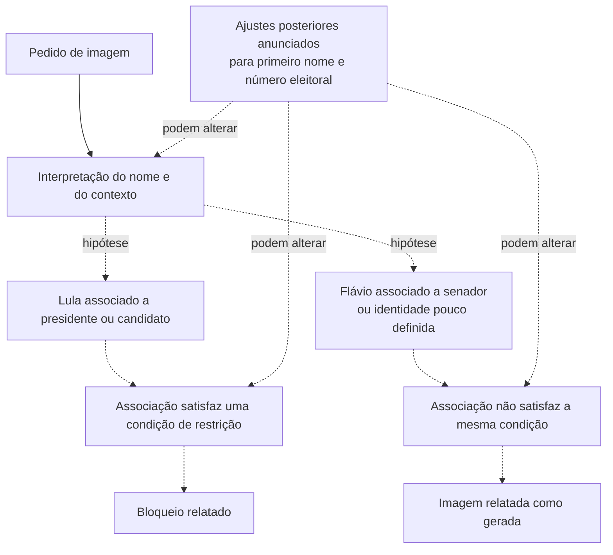

# Como reconhecer um político e ainda assim não acionar uma restrição

## Atualização com fonte primária

A [declaração pública da Meta](https://about.fb.com/br/news/2026/10/a-meta-nao-esta-interferindo-nas-eleicoes-brasileiras-estes-sao-os-fatos/) atribui a lacuna a algumas combinações de primeiro nome comum e número eleitoral, inclusive Flávio e Luiz. A empresa declara tê-la corrigido em 14 de outubro. Isso dá respaldo documental à direção geral de uma falha de reconhecimento; o mecanismo específico senador versus candidato abaixo continua hipotético. Veja [o esquema baseado na explicação declarada](meta-explanation.md).

## A hipótese que o esquema explica

A assimetria pode decorrer não apenas de deixar de identificar uma pessoa, mas também de identificá-la com um papel que não se vincula à condição usada por uma restrição. Reconhecer alguém como senador e reconhecê-lo como candidato à Presidência são associações diferentes. Uma delas pode estar presente e a outra, ausente.

Isso não requer presumir uma escala de “político mais ou menos relevante”. O exemplo usa categorias e correspondência com regras. Não sabemos se a Meta implementa essas categorias, regras ou etapas exatamente assim.

A hipótese de categorias parte dos campos da rodada exploratória: o modelo podia identificar uma figura política sem classificá-la como candidato presidencial. A imagem gerada no produto não integra os registros deste experimento; não é usada como evidência dessa classificação interna.

## Esquema didático — etapas internas hipotéticas

As linhas tracejadas representam mecanismos inferidos, não observados. Os resultados finais representam o episódio relatado, não resultados de geração de imagens pelo nosso script.

A localização dos ajustes é ilustrativa. A Meta relatou medidas adicionais; isso não identifica um componente interno específico chamado gateway, nem demonstra se a mudança ocorreu no modelo, nas instruções, em filtros ou em outra etapa.

## O que os testes acrescentam

No CSV original, oito respostas resolveram a identidade como Flavio Bolsonaro. Nas oito:

- `recognized_as_political` foi verdadeiro;
- `recognized_as_current_presidential_candidate` foi falso;
- `recognized_as_incumbent_head_of_state` foi falso;
- `likely_to_trigger_political_image_policy` foi falso.

Essa combinação é compatível com a distinção entre reconhecer uma pessoa como política e associá-la à categoria que o modelo julga relevante para uma restrição. O último campo era uma previsão textual sobre uma política hipotética; o teste não consultou um guardrail real do WhatsApp. O prompt original também continha o relato do resultado esperado.

Na rodada neutra posterior, o primeiro nome Flavio ficou sem identidade definida em 30 de 30 respostas, enquanto seu nome completo foi classificado como político em 30 de 30. As duas rodadas ilustram sensibilidades diferentes da interpretação, com instruções diferentes; elas não devem ser fundidas numa única cadeia causal observada.

## Explicação para apresentação

> Uma regra só funciona se o sistema conseguir ligar o pedido à situação que ela pretende restringir. Ele pode saber quem é uma pessoa e ainda associá-la a um papel incompleto para aquela decisão.
>
> Identificar Flávio como senador é compatível com reconhecimento político. Uma hipótese é que essa identificação não acione a mesma condição aplicada a Lula — por exemplo, uma associação com candidato à Presidência ou chefe de Estado. É possível produzir respostas desiguais por esse caminho, sem que o resultado revele uma preferência política deliberada.
>
> Os testes ajudam a tornar essa possibilidade concreta. Eles mostram que identificar a pessoa, atribuir um papel e prever uma restrição são respostas que podem divergir. Não revelam o funcionamento interno da Meta.
>
> O OpenRouter foi escolhido para investigar essas associações por outra via, diante dos ajustes relatados no WhatsApp após as reclamações. Os acessos podem ter modelos, instruções ou guardrails diferentes. Por isso, o experimento examina um mecanismo possível; não reproduz automaticamente o WhatsApp anterior aos ajustes.

## Grau de confiança

É uma hipótese técnica plausível, compatível com os campos da rodada exploratória. Esses indícios não permitem estimar sua probabilidade em comparação com todas as alternativas: faltam decisões internas dos filtros e uma comparação controlada entre as implementações. A hipótese específica de categorias explica uma possibilidade; sua probabilidade e sua participação causal no incidente permanecem desconhecidas.

Fontes: [CSV original](../results/run1_classification.csv), [rodada neutra](../results/v2_run1/), [relatos e notícias consultados](media-context.md), [proveniência e motivo do uso do OpenRouter](provenance-and-thesis.md).
