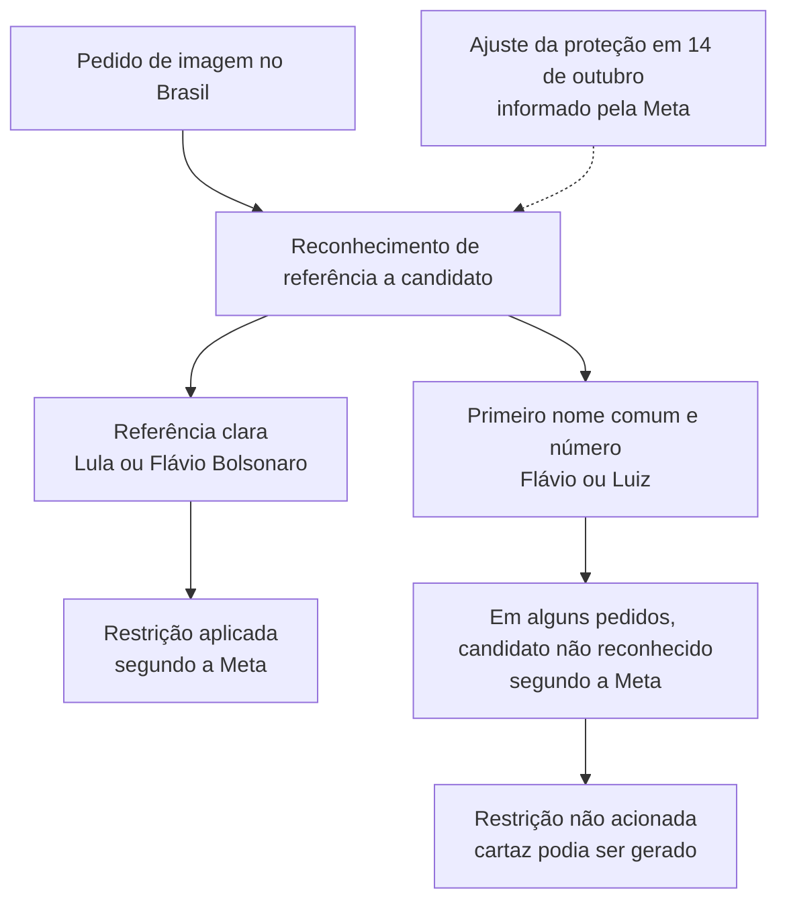

# A explicação pública da Meta e sua relação com o experimento

Fonte primária consultada em 25 de outubro de 2026: [A Meta não está interferindo nas eleições brasileiras. Estes são os fatos.](https://about.fb.com/br/news/2026/10/a-meta-nao-esta-interferindo-nas-eleicoes-brasileiras-estes-sao-os-fatos/)

A fonte foi localizada a partir da [conversa compartilhada por Pedro](https://chatgpt.com/share/6addbdfb-817c-83e9-9f47-ee280e844d1e), intitulada *Technical explanation of alleged favoritism*, com mensagens de 16 e 17 de outubro. A página compartilhada foi lida e o comunicado citado foi consultado diretamente. O texto do assistente na conversa anterior não é tratado como comprovação independente. Não foi encontrada uma imagem de Flávio como senador no conteúdo acessível desse compartilhamento.

## O que a Meta declara sobre a geração de imagens

A empresa afirma que havia restringido temporariamente recomendações e imagens de candidatos no Brasil. Sobre 14 de outubro, descreve uma lacuna de reconhecimento: as proteções identificavam referências claras, incluindo os nomes completos dos dois candidatos, mas falhavam em algumas combinações de primeiro nome comum e número eleitoral.

O trecho central é: **“nem sempre reconheciam um candidato quando um primeiro nome comum era combinado com um número eleitoral.”**

Segundo a declaração:

- referências claras a Lula e a Flávio Bolsonaro eram bloqueadas;
- algumas combinações de Flávio com seu número permitiam gerar cartazes;
- a mesma lacuna permitia algumas combinações de Luiz com o número de Lula;
- uma proibição indiscriminada de primeiros nomes comuns atingiria pedidos cotidianos sem conteúdo político;
- a empresa corrigiu essa lacuna no mesmo dia, 14 de outubro.

Isso documenta uma explicação de reconhecimento e aplicação das proteções fornecida pelo operador do sistema. Não equivale à inspeção independente dos logs nem demonstra todos os detalhes internos da arquitetura. A negativa de intenção política também é uma posição da empresa, não uma conclusão causal produzida pelo nosso experimento.

## Esquema da explicação declarada

As caixas resumem decisões funcionais descritas no comunicado; não representam componentes internos cuja implementação tenhamos observado.

## Como isso se relaciona com as evidências de Pedro

1. **Motivação do OpenRouter.** Investigar outra via é metodologicamente pertinente diante de uma alteração declarada no produto após as reclamações. Permite examinar hipóteses sobre reconhecimento sem depender exclusivamente do WhatsApp já ajustado. Não demonstra que o OpenRouter conserve o estado anterior nem que utilize instruções, versão e filtros idênticos.
2. **Rodada neutra.** A identificação política em 30/30 respostas para cada nome completo e a ausência de identificação em 30/30 respostas para Flavio isolado são compatíveis com sensibilidade à forma do nome. Os prompts e a tarefa diferem dos pedidos de imagens no WhatsApp, portanto isso não é uma replicação do incidente.
3. **Rodada original.** Nas oito respostas que resolveram Flavio Bolsonaro, o modelo reconheceu uma figura política, não o classificou como candidato presidencial ou chefe de Estado, e não previu acionamento de uma restrição hipotética. Isso ilustra que identidade, papel e previsão de política podem divergir. O prompt dessa rodada continha o resultado observado, uma limitação importante.
4. **Relato de senador.** Pedro relata que a imagem mostrava Flávio como senador. Isso é compatível com associação a um papel político que pode não coincidir com a categoria relevante para uma restrição. O comunicado não confirma essa categoria como causa, e o conteúdo da imagem não revela a decisão interna do moderador.

A direção ampla da tese passa, portanto, a ter uma fonte primária específica: uma falha de reconhecimento pode fazer uma proteção política produzir resultados desiguais. A explicação mais estreita de que o filtro reconheceu senador, mas não candidato presidencial, permanece uma hipótese adicional.

## O que não transportar da conversa anterior como fato

- Os números exemplificativos de probabilidade de um classificador naquela resposta eram ilustrações, não medições. Não entram no esquema ou nos resultados.
- A comparação de 25 horas versus 7 horas não é validada pela conversa; é necessário distinguir postagem, impulsionamento e outras funcionalidades, além de incidentes e datas.
- A existência de uma defesa com dados técnicos não significa que todos os logs estejam públicos ou tenham sido examinados por nós.

## Outros incidentes citados no comunicado

A Meta também atribui a suspensão temporária de uma conta de anúncios a uma classificação antifraude incorreta, distingue problemas de contagem de visualizações de interrupções de distribuição e descreve uma falha de criação de anúncios ligada a uma atualização de código. Essas são explicações da empresa para incidentes distintos. Elas reforçam a necessidade de definir qual funcionalidade falhou antes de agrupar todos os casos sob uma única causa; não foram verificadas com telemetria neste projeto.

## Texto para apresentação

> A hipótese de falha no reconhecimento não vem apenas dos nossos testes. A própria Meta declarou que suas proteções nem sempre reconheciam um candidato quando o pedido usava primeiro nome comum e número eleitoral. Segundo a empresa, isso ocorria com Flávio e também com Luiz, e a proteção foi ajustada em 14 de outubro.
>
> Nosso experimento por outra via torna compreensível esse tipo de dificuldade: a forma do nome muda a identificação, e reconhecer alguém como político não garante associá-lo à mesma categoria usada por uma restrição.
>
> Não conhecemos a implementação interna nem examinamos os logs da Meta. Podemos apresentar o mecanismo como uma explicação documentada pela empresa e compatível com nossos resultados, preservando a distinção entre essa explicação, as observações e aquilo que ainda permanece hipótese.
